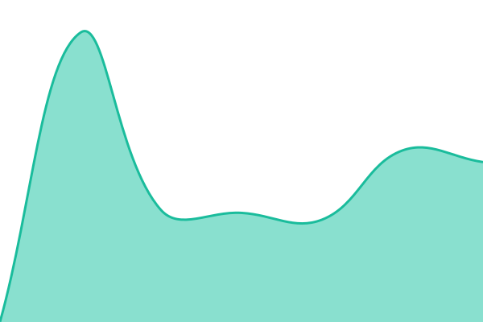
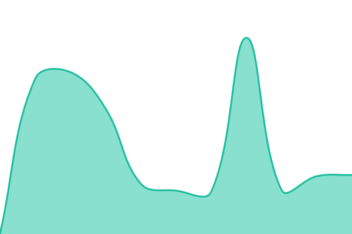
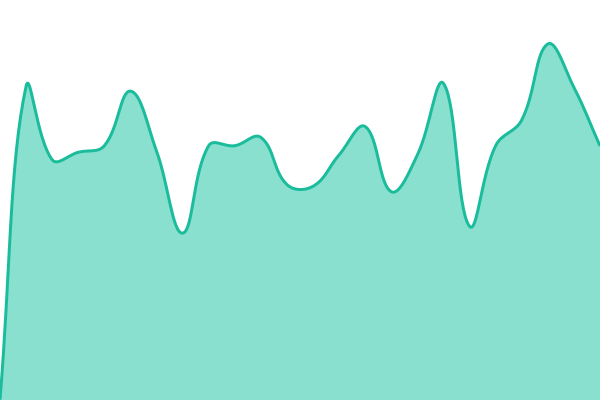

# [📈 Live Status](https://yhlhoh.github.io/NewVision_status): <!--live status--> **🟧 Partial outage**

This repository contains the open-source uptime monitor and status page for [Zheng ze Ou](yhlblog.eu.org), powered by [Upptime](https://github.com/upptime/upptime).

With [Upptime](https://upptime.js.org), you can get your own unlimited and free uptime monitor and status page, powered entirely by a GitHub repository. We use [Issues](https://github.com/yhlhoh/NewVision_status/issues) as incident reports, [Actions](https://github.com/yhlhoh/NewVision_status/actions) as uptime monitors, and [Pages](https://yhlhoh.github.io/NewVision_status) for the status page.

<!--start: status pages-->
<!-- This summary is generated by Upptime (https://github.com/upptime/upptime) -->
<!-- Do not edit this manually, your changes will be overwritten -->
<!-- prettier-ignore -->
| URL | Status | History | Response Time | Uptime |
| --- | ------ | ------- | ------------- | ------ |
|  [NewVision_Live](https://nv.y-dev.tech) | 🟥 Down | [new-vision-live.yml](https://github.com/yhlhoh/NewVision_status/commits/HEAD/history/new-vision-live.yml) | 

 0ms
     
 | 

<a href="https://yhlhoh.github.io/NewVision_status/history/new-vision-live">0.00%</a>
    

|  [NewVision_Git](https://git.newvision.y-dev.tech) | 🟥 Down | [new-vision-git.yml](https://github.com/yhlhoh/NewVision_status/commits/HEAD/history/new-vision-git.yml) | 

 0ms
     
 | 

<a href="https://yhlhoh.github.io/NewVision_status/history/new-vision-git">0.00%</a>
    

|  [NewVision_SSO](https://sso.newvision.y-dev.tech) | 🟥 Down | [new-vision-sso.yml](https://github.com/yhlhoh/NewVision_status/commits/HEAD/history/new-vision-sso.yml) | 

 1546ms
     
 | 

<a href="https://yhlhoh.github.io/NewVision_status/history/new-vision-sso">55.05%</a>
    

|  [NewVision_NAS](https://ftp.newvision.y-dev.tech) | 🟩 Up | [new-vision-nas.yml](https://github.com/yhlhoh/NewVision_status/commits/HEAD/history/new-vision-nas.yml) | 

 888ms
     
 | 

<a href="https://yhlhoh.github.io/NewVision_status/history/new-vision-nas">85.50%</a>
    

|  [NewVision_DocSpace](https://docs.newvision.y-dev.tech) | 🟥 Down | [new-vision-doc-space.yml](https://github.com/yhlhoh/NewVision_status/commits/HEAD/history/new-vision-doc-space.yml) | 

 0ms
     
 | 

<a href="https://yhlhoh.github.io/NewVision_status/history/new-vision-doc-space">0.00%</a>
    

<!--end: status pages-->

[**Visit our status website →**](https://yhlhoh.github.io/NewVision_status)

## 📄 License

- Powered by: [Upptime](https://github.com/upptime/upptime)
- Code: [MIT](./LICENSE) © [Anand Chowdhary](https://anandchowdhary.com)
- Data in the `./history` directory: [Open Database License](https://opendatacommons.org/licenses/odbl/1-0/)
